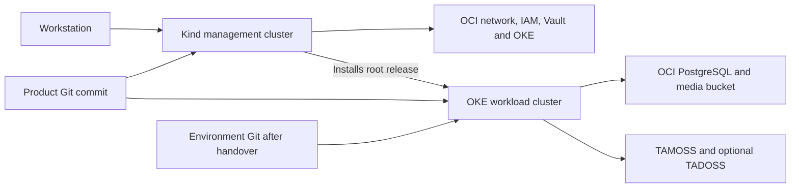

# Architecture

Kind provisions the OCI infrastructure. Controllers inside OKE provision the data services and run TAMOSS. Once OKE is ready, `up` stops Kind. The store continues serving requests while Kind is stopped.

## Resource ownership

| Owner | Resources and access |
| --- | --- |
| OCI administrator | Compartment, provisioner and signing key |
| Crossplane in Kind | `TamossBootstrap`, network, OKE cluster and workers, reserved IP, storage identity, IAM policies, Vault and encryption key |
| Flux in Kind | Management controllers and the `oke-root` HelmRelease on OKE |
| Crossplane in OKE | `TamossServices`, the PostgreSQL system and private media bucket, using OKE workload identity |
| Flux and application operators in OKE | Platform releases, application workloads, database migrations and readiness |
| OKE cloud controller | Public load balancer for the Traefik Service |

The host uses its OCI profile to reach OKE. Kind uses a separate, non-expiring ServiceAccount token for the root release and retirement. `down` revokes that access after OKE has acknowledged service retirement.

## Data and credentials

TAMOSS and Authentik use separate databases and roles on the same PostgreSQL system. Clients verify the database hostname and CA. An external `StorageBackend` registers the private bucket with TAMOSS. Browsers read media using presigned URLs. [TADOSS](../deploy/tadoss/README.md) uses its own database for timed metadata.

Kind creates a bucket-scoped storage identity and records the IDs before creating a Customer Secret Key. External Secrets persists credentials in OCI Vault and delivers them to OKE. Workload identity lets OKE manage its services without the provisioner's signing key.

## Availability and teardown

Application, authentication and ingress replicas run across workers with disruption budgets. The scope of worker-drain and recovery testing is in [Testing](testing.md#verified-coverage-and-limits).

The original Kind cluster holds the management state for the resources it created. During [teardown](operations.md#destroy-the-environment), OKE removes its workloads and data services before Kind removes OKE and its network. The compartment, Vault and encryption key survive workload deletion.
