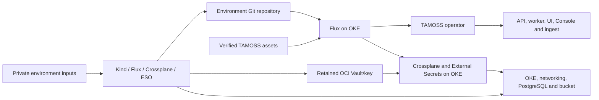

# Architecture

[Overview](../README.md) | [Getting started](getting-started.md) | [Operations](operations.md) | [Testing](testing.md)

Flux in Kind installs Crossplane and External Secrets from a private seed.
Crossplane creates the retained OCI Vault/key and the OKE environment.
Flux, Crossplane and External Secrets on OKE take over ongoing reconciliation.
The original Kind stops after verified ownership transfer and is retained for
teardown. Git owns desired configuration after the initial export.

Kind receives a `TamossBootstrap` composite containing the foundation and
environment inputs. Flux installs providers, functions and composition APIs,
then the bootstrap instance, using release dependencies and native retries.
Crossplane creates the retained foundation, then creates the
infrastructure child once the foundation is Ready and ESO has delivered this
deployment's database credential. Those dependencies reconcile without a running
Task process. The root reports foundation, credential and infrastructure readiness
separately; application readiness remains the responsibility of the OKE controllers.
The root also composes HelmReleases for secret delivery and runtime IAM, deriving
their values from observed Vault/key and OKE IDs. Flux owns their Helm operations.

Task still supplies the initial credential imports, OCI access, Git publication
and remote bootstrap. Ownership transfer, qualification and cleanup remain explicit
operations. Before handover or teardown, Task freezes the bootstrap-instance
HelmRelease and excludes an in-flight Helm action. It then irreversibly releases the root's
configuration authority and confirms its reconciliation is paused. This prevents
bootstrap settings or child recreation from competing with subsequent operations.
Release and pause are both required: the release flag alone can still reapply an observed
child snapshot. Repeated release keeps an already released root paused, including
after its inputs change.

See the [GitOps integration](../deploy/gitops/README.md) for adoption gates and
secret delivery. Release upgrade and package-read credential rotation/revocation
remain unqualified.

## Ownership

| Owner | Responsibility |
| --- | --- |
| Account administrator | Dedicated compartment, scoped OCI identities, policies and signing/storage keys |
| Crossplane | Kind initially owns the environment; OKE takes the same provider bindings after verified handover |
| OKE cloud controller | Load balancer created by the ingress `LoadBalancer` Service |
| Flux | Kind bootstrap releases; OKE platform releases, HA/OCI overlays, controllers and TAMOSS declarations |
| TAMOSS operator | Application workloads, runtime images, schema migrations, StorageBackend and IngestRun Jobs |
| Database bootstrap Job | Separate TAMOSS and Authentik databases and login roles |
| Operator of this environment | Spending deadline, qualification, retained records and verified cleanup |

Flux takes release ownership and Crossplane on
OKE takes infrastructure ownership through observe-only adoption and exact
provider bindings. Only one control plane may write at a time. The original Kind
is retained without write authority, stopped, and later receives current Git/live
configuration for deletion. This does not recover lost Kind state.

After the remote Flux seed is submitted, its controllers fetch Git and create
the runtime releases through their declared dependencies. The host installs ESO
and secret delivery only in `flux-system`, allowing Flux to read Git and GHCR.
Flux installs secret delivery in the application and infrastructure namespaces.

Deployment completion observes the selected Git revision, current product chart
and HelmRelease generation, then the `deployment-ready` Flux health check.
That check includes infrastructure, secret delivery, TAMOSS and enabled TADOSS.
Routine `up` and `qualify` readiness checks do not force application reconciliation;
ownership promotion also observes normal Flux reconciliation at the published revision.

Crossplane owns the reserved public IP; the OKE cloud controller attaches it to
the load balancer. Handover compares the address, resource identity and desired
configuration, excluding attachment status that the two control planes may
observe at different times.

The OKE PostgreSQL provider polls every minute so observe-only adoption can
refresh status within the five-minute readiness check. Its first observation
can lose status when the provider adds its Kubernetes finaliser. The next poll
restores it without restarting the provider; Ready, Synced and identity checks
still control ownership transfer.

The optional [TADOSS integration](../deploy/tadoss/README.md) uses the same OKE,
PostgreSQL, authentication, ingress and secret services. Git enables its released
operator and API/worker replicas, a separate database/role and an OAuth client.
TADOSS owns its schema migrations and stores timed metadata referencing TAMS
media. This repository owns the platform configuration; both upstream products
are consumed read-only. Git enablement, authenticated linked-media checks and
persistence after pod replacement passed with Kind stopped. OCI resource IDs
remained unchanged across enablement. See the [qualification limits](testing.md#verified-coverage-and-limits).

## Configuration flow

| Source | Purpose |
| --- | --- |
| [Environment examples](../environments/example/) | Private region, placement, capacity, settings and cost inputs |
| [Environment schema](../charts/environment/definition.yaml) | Typed infrastructure contract and immutable fields |
| [Bootstrap chart](../charts/bootstrap/) | Kind root, child dependencies and release state; reuses the foundation and environment schemas |
| [dependencies.yaml](../dependencies.yaml), [aqua.yaml](../aqua.yaml) | Infrastructure component selections/checksums and workstation tools |
| [TAMOSS release lock](../deploy/tamoss/release.yaml) | Verified release record and matching source archive |
| [TAMOSS integration](../deploy/tamoss/README.md) | Platform settings, instance overlays, database bootstrap and qualification assets |

Crossplane observations become `outputs.json` and initialise the environment Git
configuration. Flux derives sslip.io hostnames from the reserved IP. A bounded
OCI CLI Job obtains the current database hostname and CA. Make subsequent desired
changes in the environment repository; repeating `up` preserves them.

TAMOSS's upstream manifests, charts, profile and tests are consumed unchanged from
the selected release. A sibling checkout is unnecessary. The operator's release
catalogue owns application image digests and schema revisions. See
[release selection](../deploy/tamoss/README.md#release-selection).

## Availability and external services

Three OKE workers use explicit availability/fault-domain placements. Application,
authentication, ingress and operator replicas use worker separation and disruption
budgets. The API and authentication servers delay shutdown for endpoint withdrawal;
ingress allows the OCI backend to be withdrawn before it stops accepting requests.

Both TAMOSS and Authentik use the provisioned, two-node OCI PostgreSQL system.
Separate roles/databases share its endpoint. Consumers verify the server's
certificate and hostname using the retrieved CA. The bootstrap Job creates roles
and databases; TAMOSS owns its schema migrations. Database backups follow the
configured retention, but teardown deletes the owned system and its backups.

The private OCI bucket stores media. TAMOSS registers it through an external
StorageBackend and uses the S3-compatible HTTPS endpoint for application and
browser media access. A separate bucket-scoped Customer Secret Key supplies
storage access. Qualification's ingest source is restricted to its input prefix.

Worker-drain availability has passed live checks. That result does not establish
managed-database failover, regional recovery or management-state restoration.
See the [coverage limits](testing.md#verified-coverage-and-limits).

## Secrets and retained state

Owner-only credential inputs remain in the private environment directory. Kind
creates or adopts a separately retained OCI Vault/key. External Secrets persists initial values, reads them back and delivers them
to OKE using scoped workload identities. Git contains non-secret configuration and
provider bindings. The environment repository contains neither TAMOSS source nor
secret payloads. See [secret delivery](../deploy/gitops/README.md#inputs-and-secret-delivery).

After persistence is verified, bootstrap disables initial credential creation and
removes staging inputs. The bootstrap instance records `credentialsEstablished`
irreversibly; its secret HelmRelease then removes generators and PushSecrets.
The Kind product source switches to the delivered Git credential before its
import Secret is removed. A missing established value must fail secret delivery
without silently generating a replacement. Secret retirement remains an explicit
operation with a separate check of OCI's asynchronous deletion state.

Keep original Kind state, deployment identity, release records and cloud inventory
until deletion is verified. [Operations](operations.md#destroy-the-environment)
lists the resources deleted and retained.
