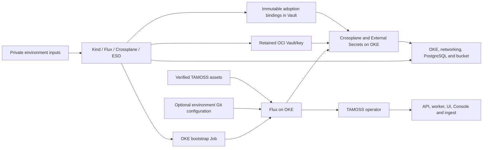

# Architecture

[Overview](../README.md) | [Getting started](getting-started.md) | [Operations](operations.md) | [Testing](testing.md)

Flux in Kind installs Crossplane and External Secrets from a private seed.
Crossplane creates the retained OCI Vault/key and the OKE environment.
Flux, Crossplane and External Secrets on OKE take over ongoing reconciliation.
The original Kind stops after verified ownership transfer and is retained for
teardown. The quick deployment seeds configuration from the private local
directory. Optional handover publishes it to Git; Vault holds generated
credentials and adoption bindings.

Kind receives a `TamossBootstrap` composite containing the foundation and
environment inputs. Flux installs providers, functions and composition APIs,
then the bootstrap instance, using release dependencies and native retries.
Crossplane submits the retained foundation and infrastructure together. Networking,
OKE, the bucket and public IP can progress while Vault is unavailable. The database
provider requires the persisted credential through its Secret reference before it
can create the database. Those dependencies reconcile without a running
mise process. The root reports foundation, credential, bootstrap and infrastructure readiness
separately; application readiness remains the responsibility of the OKE controllers.
The root also composes HelmReleases for secret delivery and runtime IAM, deriving
their values from observed Vault/key and OKE IDs. Flux owns their Helm operations.

Once OKE and its workers, runtime IAM and persisted credentials are ready, the
root creates the `oke-bootstrap` Job in Kind. Its pinned OCI CLI retrieves the
OKE kubeconfig; native init containers validate cluster identity, install Flux
and apply the deployment seed. Kubernetes owns retries and the execution deadline.
The database can continue provisioning during this work. A restricted local
ServiceAccount records the connection and successful seed in `oke-connection`;
it cannot read other Secrets through the API. The OCI signing key stays in Kind.

mise still supplies the initial credential imports, verifies persistence and
retires staging credentials and reads the completed connection. Git publication
and deploy-key establishment occur only during optional handover.
Ownership transfer, qualification and cleanup remain explicit
operations. Before handover or teardown, mise freezes the bootstrap-instance
HelmRelease and excludes an in-flight Helm action. It then irreversibly releases the root's
configuration authority and confirms its reconciliation is paused. This prevents
bootstrap settings or child recreation from competing with subsequent operations.
Release also removes the bootstrap Job and waits for its Pods to disappear before
ownership transfer or teardown. Release and pause are both required: the release flag alone can still reapply an observed
child snapshot. Repeated release keeps an already released root paused, including
after its inputs change.

See the [GitOps integration](../deploy/gitops/README.md) for adoption gates and
secret delivery. Release upgrades and credential rotation remain unqualified.

## Ownership

| Owner | Responsibility |
| --- | --- |
| Account administrator | Dedicated compartment, scoped OCI identities, policies and signing/storage keys |
| Crossplane | Kind initially owns the environment; OKE takes the same provider bindings after verified handover |
| OKE cloud controller | Load balancer created by the ingress `LoadBalancer` Service |
| Flux | Kind bootstrap releases; OKE platform releases, HA/OCI overlays, controllers and TAMOSS declarations |
| TAMOSS operator | Application workloads, runtime images, schema migrations, StorageBackend and IngestRun Jobs |
| Database bootstrap Job | Separate TAMOSS and Authentik databases and login roles |
| Operator of this environment | Account access, qualification, retained records and explicit verified cleanup |

Flux takes release ownership and Crossplane on
OKE takes infrastructure ownership through observe-only adoption and exact
provider bindings. Only one control plane may write at a time. The original Kind
is retained without write authority, stopped, and later receives current Git/live
configuration for deletion. This does not recover lost Kind state.

After the remote Flux seed is submitted, its controllers fetch Git and create
the runtime releases through their declared dependencies. The Kind Job seeds Flux with
the already persisted, read-only Git App credential and the Vault identifier.
Flux installs ESO and infrastructure controllers independently of database outputs.
ESO takes ownership of the seeded credential and delivers GHCR credentials and
adoption bindings. This lets OKE bootstrap while PostgreSQL is still provisioning.

The connection record contains the deployment ID, OCI cluster ID, remote
namespace UID, API server and kubeconfig. Completion prevents the Job being
recreated after it has been removed. Subsequent operations use Git and the OKE
controllers. The host uses the pinned native OCI CLI for renewable kubeconfig
tokens, inventory, qualification and cleanup.

Deployment completion observes the selected infrastructure and runtime Git revision, current product chart
and HelmRelease generation, then the `deployment-ready` Flux health check.
That check includes infrastructure, secret delivery, TAMOSS and enabled TADOSS,
plus their public certificates and Authentik's certificate at the current generation.
Routine `up` and `qualify` readiness checks do not force application reconciliation;
ownership promotion also observes normal Flux reconciliation at the published revision.
`up` finishes with Kind owning infrastructure and OKE observing it. The separate
`handover` command checks the published deployment before transfer and the
promoted revision before Kind stops. Handover completion is recorded only after
that stop succeeds. Flux manages applications throughout; the transfer changes
infrastructure authority without changing application settings.

Crossplane owns the reserved public IP; the OKE cloud controller attaches it to
the load balancer. Handover compares the address, resource identity and desired
configuration, excluding attachment status that the two control planes may
observe at different times.

The OKE PostgreSQL provider polls every minute so observe-only adoption can
refresh status within the five-minute readiness check. Its first observation
can lose status when the provider adds its Kubernetes finaliser. The next poll
restores it without restarting the provider; Ready, Synced and identity checks
still control ownership transfer.

The optional [TADOSS integration](../deploy/tadoss/README.md) uses the same OKE,
PostgreSQL, authentication, ingress and secret services. Git enables its released
operator and API/worker replicas, a separate database/role and an OAuth client.
TADOSS owns its schema migrations and stores timed metadata referencing TAMS
media. This repository owns the platform configuration; both upstream products
are consumed read-only. Git enablement, authenticated linked-media checks and
persistence after pod replacement passed with Kind stopped. OCI resource IDs
remained unchanged across enablement. See the [qualification limits](testing.md#verified-coverage-and-limits).

## Operational Jobs

The OKE bootstrap, database connection and secret-retirement Jobs use native CLI
commands in ordered init containers. Kubernetes owns retries and deadlines.
Images are pinned through `dependencies.yaml`; containers run without root or
privilege escalation, with read-only root filesystems and bounded memory-backed
temporary storage. Credentials use Secret references. Validated non-secret
outputs may use ConfigMaps; credential payloads stay in Secrets and Vault.

The database connection and secret-retirement charts share these settings through
the [operation-common library](../charts/operation-common/). Helmfile and Flux
resolve its local chart dependency. Local rendering builds it through the existing
checks. The Crossplane bootstrap template has a separate rendering stage and
conforms to the same tested contract without importing Helm helpers.

| Operation | Owner and location | Inputs and completion |
| --- | --- | --- |
| OKE bootstrap | Crossplane in original Kind | Cluster/deployment identity, seed ConfigMap and OCI Secret references; identity-bound `oke-connection` Secret records completion |
| Database connection | Flux HelmRelease in OKE, namespace `auth` | Database ID, refresh revision and workload identity; validates hostname/CA before patching the named `database-connection` ConfigMap |
| Secret retirement | Helmfile during teardown in original Kind | Deployment prefix, Vault/compartment IDs and OCI Secret references; completes when listed matching secrets are pending deletion or deleted |

Jobs can execute more than once. Each operation therefore keeps its own recovery
and identity checks; Job completion alone does not provide exactly-once execution.
See [recovery procedures](operations.md#operational-job-recovery).

## Configuration flow

| Source | Purpose |
| --- | --- |
| [Setup values](../environments/example/values.yaml) and [defaults](../charts/setup/values.yaml) | Operator choices and the HA configuration; regional discovery and complete declarations are recorded privately |
| [Environment schema](../charts/environment/definition.yaml) | Typed infrastructure contract and immutable fields |
| [Bootstrap chart](../charts/bootstrap/) | Kind root, child dependencies and release state; reuses the foundation and environment schemas |
| [dependencies.yaml](../dependencies.yaml), [mise.toml](../mise.toml) | Infrastructure component selections/checksums and workstation tools |
| [TAMOSS release lock](../deploy/tamoss/release.yaml) | Verified release record and matching source archive |
| [TAMOSS integration](../deploy/tamoss/README.md) | Platform settings, instance overlays, database bootstrap and qualification assets |

Once all cloud resources are ready, Kind's Crossplane creates an immutable snapshot
of the deployment identity, creation UID and all 23 provider bindings. ESO persists
it with `IfNotExists`; bootstrap compares the readback with the original snapshot.
OKE's ESO delivers that record to the infrastructure Kustomization. Missing or
changed bindings block adoption instead of creating replacement infrastructure.

OKE Crossplane produces the `tamoss-infra/tamoss-runtime` ConfigMap from its own
observations. The runtime Kustomization supplies these values to the application
release. Both integration HelmReleases and their values ConfigMaps reside in
`tamoss-infra`; Flux controllers and sources remain in `flux-system`.
Local `outputs.json` remains an inspection and qualification record.
Flux derives sslip.io hostnames from the reserved IP. A bounded
OCI CLI Job obtains the current database hostname and CA. Make subsequent desired
changes in the environment repository; repeating `up` preserves them.

TAMOSS's upstream manifests, charts, profile and tests are consumed unchanged from
the selected release. A sibling checkout is unnecessary. The operator's release
catalogue owns application image digests and schema revisions. See
[release selection](../deploy/tamoss/README.md#release-selection).

## Availability and external services

Three OKE workers use explicit availability/fault-domain placements. Application,
authentication, ingress and operator replicas use worker separation and disruption
budgets. The API and authentication servers delay shutdown for endpoint withdrawal;
ingress allows the OCI backend to be withdrawn before it stops accepting requests.

Both TAMOSS and Authentik use the provisioned, two-node OCI PostgreSQL system.
Separate roles/databases share its endpoint. Consumers verify the server's
certificate and hostname using the retrieved CA. The bootstrap Job creates roles
and databases; TAMOSS owns its schema migrations. Database backups follow the
configured retention, but teardown deletes the owned system and its backups.

The private OCI bucket stores media. TAMOSS registers it through an external
StorageBackend and uses the S3-compatible HTTPS endpoint for application and
browser media access. A separate bucket-scoped Customer Secret Key supplies
storage access. Qualification's ingest source is restricted to its input prefix.

Worker-drain availability has passed live checks. That result does not establish
managed-database failover, regional recovery or management-state restoration.
See the [coverage limits](testing.md#verified-coverage-and-limits).

## Secrets and retained state

Owner-only credential inputs remain in the private environment directory. Kind
creates or adopts a separately retained OCI Vault/key. External Secrets persists initial values, reads them back and delivers them
to OKE using scoped workload identities. Git contains desired configuration and
binding references. The environment repository contains neither TAMOSS source nor
secret payloads. See [secret delivery](../deploy/gitops/README.md#inputs-and-secret-delivery).

After persistence is verified, bootstrap disables initial credential creation and
removes staging inputs. The bootstrap instance records `credentialsEstablished`
irreversibly; its secret HelmRelease then removes credential generators and PushSecrets.
The separate adoption-binding PushSecret remains until infrastructure deletion
and the direct cloud audit finish.
Product sources and release packages are read anonymously. During handover, a
separate credential-establishment step persists the generated SSH deploy key
without restarting application password generators. A missing established value must fail secret delivery
without silently generating a replacement. Secret retirement remains an explicit
operation with a separate check of OCI's asynchronous deletion state.

Keep original Kind state, deployment identity, release records and cloud inventory
until deletion is verified. [Operations](operations.md#destroy-the-environment)
lists the resources deleted and retained.
