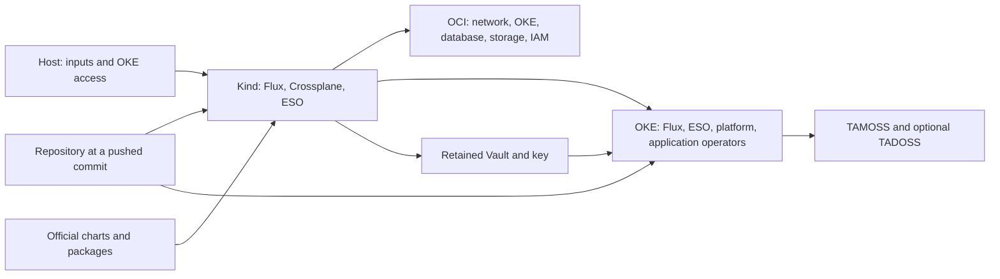

# Architecture

[Overview](../README.md) | [Getting started](getting-started.md) | [Operations](operations.md) | [Testing](testing.md)

The demo follows Host -> Kind -> OKE. Kind contains Flux, Crossplane, the OCI
providers and External Secrets. Crossplane owns OCI infrastructure until teardown.
Flux in Kind installs one root release on OKE; Flux in OKE installs the platform
and applications from it. The
[process table](../deploy/gitops/README.md#process-and-execution-context) identifies
the execution context and output of each step.

## Ownership

| Owner | Responsibility |
| --- | --- |
| Account administrator | Dedicated compartment, OCI profile, signing key and prerequisites |
| Host | Discover setup defaults, start Kind, establish private Git access, issue OKE access, read audit results and remove Kind last |
| Crossplane in Kind | Vault/key ownership, credentials, storage identity, networking, OKE/workers, PostgreSQL, bucket and reserved public IP |
| Flux in Kind | Management releases and the `oke-root` release, which places the Git source, settings and root release in OKE |
| Flux in OKE | Platform releases, overlays, application declarations and readiness |
| OKE cloud controller | Load balancer created by the ingress Service |
| Application operators in OKE | Application workloads, migrations, storage and ingest resources |

The root `TamossBootstrap` composes foundation and environment resources together.
Networking and OKE can progress while Vault credentials are prepared. PostgreSQL
creation waits for its persisted credential. Crossplane composes the secret
HelmRelease and the runtime IAM policies from observed resource IDs; Flux performs
the Helm operations.

The host records OKE's cluster ID, API endpoint and namespace UID before issuing
remote access, and installs the Flux controllers on OKE. Flux in Kind uses a
self-contained kubeconfig Secret for one release, `oke-root`. It passes the
resource IDs Crossplane observed and the deployment settings to OKE as Helm
values. Every other release is a Flux object in OKE's `tamoss-infra` namespace
and resolves its values there. A Job in OKE reads the database hostname and CA
with OKE workload identity; External Secrets delivers the Authentik values that
Helm needs from Vault. Stopping Kind does not stop reconciliation in OKE.

Kind remains the sole infrastructure owner. Teardown first suspends runtime
reconciliation, freezes the instance release and releases and pauses the bootstrap
root so it cannot recreate children. It keeps access and operators available until
application finalisers and remote Helm uninstalls finish. Cloud inventory verifies
absence before credentials and Kind are removed.

## Operational Jobs

The S3 credential, database metadata and retirement Jobs use pinned native tools,
Kubernetes deadlines and bounded retries. Containers run without root or privilege
escalation, with read-only root filesystems and bounded temporary storage. Secret
references supply credentials; validated non-secret outputs use ConfigMaps.

| Operation | Execution context |
| --- | --- |
| S3 credential creation and Vault persistence | Kind |
| Database hostname and CA retrieval | Kind, using the existing OCI bootstrap Secret |
| SQL initialisation and application migrations | OKE |
| Workload finalisation and deletion | Kind Jobs targeting OKE |
| Object/version/upload cleanup, backup deletion and secret retirement | Kind Jobs targeting OCI |

The local operation charts share [operation-common](../charts/operation-common/).
Flux resolves that dependency from Git; no custom chart publication is required.
Failures retain Job status and logs for inspection and stop the dependent lifecycle
step. Teardown retains its ownership checks and can be retried.

## Configuration flow

The host applies one Kustomize overlay to Kind: the Git source, the
`tamoss-management` HelmRelease, a ConfigMap generated from private `values.yaml`
and Secrets generated from the OCI profile. Flux installs the
[management chart](../charts/management/) from Git with those values; the chart
declares the controllers, the Crossplane APIs and the `TamossBootstrap` root.
This repository supplies the chart directories and manifests at a pinned Git commit. `pins.yaml` selects official
chart versions and upstream package/image digests. Unchanged upstream defaults,
helper charts and instance manifests are checked in and compared with their pinned
releases during local checks. See [source details](../deploy/gitops/README.md#sources-and-charts).

## Availability and external services

Three OKE workers use explicit availability/fault-domain placements. Application,
authentication, ingress and operator replicas use worker separation and disruption
budgets. The API and authentication servers delay shutdown for endpoint withdrawal;
ingress allows the OCI backend to be withdrawn before it stops accepting requests.

Both TAMOSS and Authentik use the provisioned, two-node OCI PostgreSQL system.
Separate roles/databases share its endpoint. Consumers verify the server's
certificate and hostname using the retrieved CA. The bootstrap Job creates roles
and databases; TAMOSS owns its schema migrations. Database backups follow the
configured retention, but teardown deletes the owned system and its backups.

The private OCI bucket stores media. TAMOSS registers it through an external
StorageBackend and uses the S3-compatible HTTPS endpoint for application and
browser media access. Crossplane in Kind creates a separate user and group in
the Default identity domain and grants access to the media bucket. An immutable
`storage-identity` ConfigMap records their exact IDs before the bounded Kind Job
creates a Customer Secret Key. ESO persists the one-time response in Vault
and delivers it to OKE; Crossplane sees only references and non-secret receipts.
The creation claim prevents a repeated Job from creating another key. Teardown
revokes the recorded key after workload deletion, then removes the storage IAM
resources through Crossplane. These resources remain with retained Kind during
deployment; runtime S3 access does not depend on the host. Qualification's ingest source
is restricted to its input prefix.

Crossplane records the user, group, membership and policy IDs before freezing
their management policies to `Observe,Delete`. This prevents replacement of a
recorded identity. The pinned provider does not support updating without create
permission. Readiness checks detect changes to capabilities, membership and the
bucket policy; repairing recorded IAM drift requires operator review. A Usage
protects the user until its key has been revoked. OCI and provider reconciliation
enforce removal of membership before the group can be deleted.

Worker-drain availability has passed live checks. That result does not establish
managed-database failover, regional recovery or management-state restoration.
See the [coverage limits](testing.md#verified-coverage-and-limits).

## Secrets and retained state

The host's GitHub token stays on the host. Kind receives only a repository-scoped
read-only deploy key, removed after an anonymous public-source fetch or teardown.
The OCI signing profile is supplied to Kind's existing bootstrap Secret; application
credentials are persisted in OCI Vault and delivered to OKE with workload identity.

Preserve the private environment directory and original Kind until verified cleanup.
The retained Vault/key and its ownership record survive workload teardown. Scheduled
secret deletion is verified and recorded. Fresh OCI deployment and teardown have
passed; upgrades and credential rotation remain unqualified. See the
[verified coverage](testing.md#verified-coverage-and-limits).
